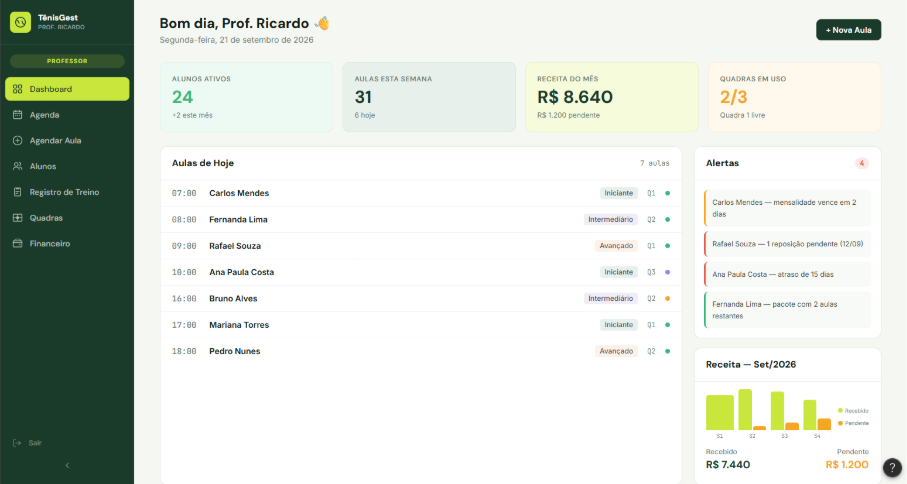

# TÊNISGEST

**Desenvolvimento de um Sistema de Gestão de Aulas Particulares de Tênis**

`CURSO` Sistemas de Informação

`DISCIPLINA` Trabalho Interdisciplinar — TI SIGE

`SEMESTRE` A confirmar pelo grupo

`INSTITUIÇÃO` Pontifícia Universidade Católica de Minas Gerais

`ANO` 2026

## Descrição do Projeto

O **TênisGest** tem como objetivo apoiar o professor autônomo de tênis na organização de alunos, horários, quadras, pagamentos e treinos. A proposta surge das dificuldades de manter essas informações em conversas, cadernos e planilhas, que podem causar conflitos de agenda, esquecimento de reposições por chuva e perda do controle das aulas contratadas.

A aplicação proposta reúne essas atividades em um único ambiente, permitindo ao professor consultar sua agenda, acompanhar pacotes e mensalidades e registrar o conteúdo trabalhado com cada aluno. Com informações organizadas, busca-se reduzir o tempo dedicado às tarefas administrativas e apoiar o planejamento das aulas e o acompanhamento técnico dos alunos.

O público-alvo é o **professor autônomo de tênis**. Nesta proposta acadêmica, os alunos são cadastros administrados pelo professor e não possuem área própria de acesso. Módulos de associação e gestor não integram o escopo.

**Etapa atual:** documentação e protótipo da interface, organizados até a **3ª etapa** do cronograma. Os textos, as imagens e as descrições foram reaproveitados do documento do grupo. O referencial/marco teórico permanece pendente, pois não consta no material recebido.

## Integrantes

- Daniela da Silva Lopes
- João José Cardoso Ribeiro
- João Vitor de Souza Franca
- Luis Gustavo de Moura Cena
- Luísa Ferreira Marques
- Marcos Vinicius Nunes dos Santos
- Renê Guimarães Ferreira Neto

## Orientador

- Paulo Augusto Isnard Santos

## Instruções de Utilização

O material pode ser consultado diretamente pelo navegador, no computador ou no celular, sem instalação. Esta etapa apresenta **imagens e descrições do protótipo**, não um aplicativo em funcionamento.

1. Comece pela [documentação de contexto](docs/visao-do-projeto.md) para conhecer o problema, a justificativa e os objetivos.
2. Consulte o [escopo](docs/escopo.md) e os [requisitos](docs/requisitos.md) para entender as funções previstas para o professor.
3. Abra o [protótipo da interface](docs/prototipo.md) para visualizar as 12 imagens originais e suas descrições. Clique em uma imagem para ampliá-la no GitHub.
4. Confira a [organização da entrega](docs/organizacao-da-entrega.md) para identificar as adaptações e a pendência do referencial teórico.

As telas apresentam o acesso do professor, o painel inicial, a agenda, o agendamento de aulas, a gestão de alunos, o registro de treinos, as quadras e o controle financeiro. Os dados exibidos são fictícios, conforme informado no documento de origem. A opção de aluno visível na imagem original do login está fora do recorte desta entrega.

## Documentação

| Documento | Conteúdo |
| --- | --- |
| [Visão do Projeto](docs/visao-do-projeto.md) | Índice da documentação e identificação do trabalho |
| [Introdução](docs/introducao.md) | Contexto e proposta do TênisGest |
| [Problemática](docs/problematica.md) | Dificuldades na rotina do professor |
| [Justificativa](docs/justificativa.md) | Relevância prática e acadêmica |
| [Objetivos](docs/objetivos.md) | Objetivo geral e objetivos específicos |
| [Escopo do Protótipo](docs/escopo.md) | Funcionalidades e limites da proposta |
| [Referencial / Marco Teórico](docs/referencial-teorico.md) | **Pendente no documento recebido** |
| [Requisitos do Sistema](docs/requisitos.md) | Requisitos funcionais e não funcionais |
| [Protótipo da Interface](docs/prototipo.md) | Imagens e descrições das telas |
| [Organização da Entrega](docs/organizacao-da-entrega.md) | Origem dos materiais, adaptações e pendências |

## Código

O escopo desta entrega é a documentação e a apresentação do protótipo já existente no Word. A implementação do aplicativo pertence às etapas seguintes; não há código de aplicação, banco de dados ou configuração de ambiente para executar nesta versão do repositório.

## Apresentação

**[Consultar as 12 telas e suas descrições →](docs/prototipo.md)**

O protótipo permite apresentar a proposta de organização da rotina do professor, desde o planejamento das aulas até o acompanhamento dos treinos e pagamentos. As descrições explicam o comportamento previsto para cada tela.

## Entregas até a 3ª Etapa

| Etapa | Data no cronograma | Conteúdo |
| --- | --- | --- |
| 1ª | 31/08/2026 | Tema, título e introdução |
| 2ª | 28/09/2026 | Introdução, problemática, justificativa, objetivos e escopo do protótipo |
| 3ª | 26/10/2026 | Conteúdo anterior, referencial/marco teórico, protótipo e requisitos |

**Pendência para completar a 3ª etapa:** acrescentar o referencial/marco teórico e suas referências. As datas acima são as previstas no cronograma, sem indicar comprovação de postagem ou aprovação pelo orientador.

## Histórico de Versões

| Data | Revisão |
| --- | --- |
| 25/10/2026 | README reorganizado conforme o modelo acadêmico fornecido, com identificação, descrição do projeto, integrantes, orientador e instruções de consulta. |
| 25/10/2026 | Material organizado até a 3ª etapa com textos, 12 imagens originais e requisitos do documento, no recorte do professor. |
| 25/10/2026 | Criação do repositório acadêmico independente. |

O [histórico de commits](https://github.com/ReneGFN/tenisgest-academico/commits/main/) registra as revisões dos arquivos. Não foram atribuídas versões de implementação ou funcionalidades que ainda não fazem parte desta etapa.

## Colaboração

As orientações para revisão e participação do grupo estão em [CONTRIBUTING.md](CONTRIBUTING.md). Integrantes e orientador foram transcritos do documento do trabalho. A abreviação TI SIGE consta no cronograma; o semestre curricular deve ser confirmado pelo grupo.
