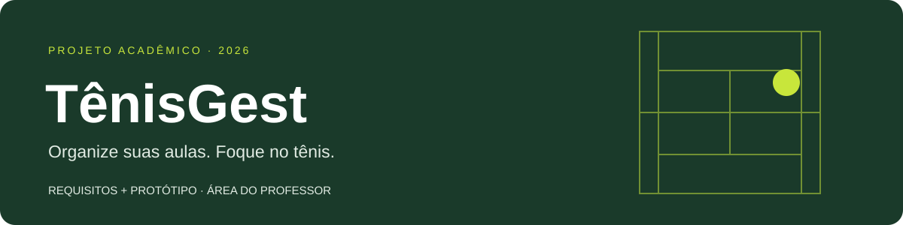
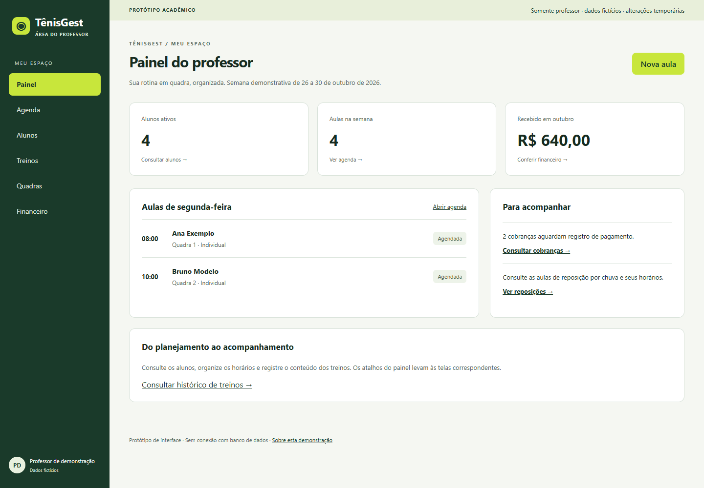

<p align="center"></p>

<p align="center"><strong>Protótipo acadêmico · Sistemas de Informação · PUC Minas · 2026</strong><br>Uma proposta simples para organizar a rotina do professor autônomo de tênis.</p>

## Sobre o projeto

O professor de tênis precisa conciliar alunos, horários, quadras, pagamentos e acompanhamento dos treinos. Quando essas informações ficam espalhadas em conversas, cadernos e planilhas, surgem conflitos de agenda e esquecimentos.

O **TênisGest** propõe reunir essas informações em uma interface web. Esta entrega contém **os requisitos e um protótipo navegável**, com escopo limitado ao **professor autônomo**. Alunos são cadastros gerenciados pelo professor; não possuem acesso próprio nesta proposta.

> **Etapa acadêmica:** este repositório demonstra telas e interações com dados fictícios. Não é um sistema operacional: não possui autenticação, servidor, banco de dados nem processamento de pagamentos. Alterações da demonstração desaparecem ao recarregar a página. Use somente informações inventadas.

## Conheça a entrega

| Material | Conteúdo |
| --- | --- |
| [Requisitos](docs/requisitos.md) | Requisitos funcionais, não funcionais, regras e critérios de aceitação |
| [Protótipo](prototipo/index.html) | Seis telas e interações demonstrativas, sem instalação |
| [Roteiro de apresentação](docs/prototipo.md) | O que mostrar, passo a passo, e limites de cada interação |
| [Contexto e escopo](docs/visao-do-projeto.md) | Problema, justificativa, objetivos e recorte da etapa |
| [Participação do grupo](CONTRIBUTING.md) | Como colaborar e revisar mudanças |



## Abrir o protótipo

1. Clique em **Code → Download ZIP** neste repositório e extraia a pasta.
2. Abra `prototipo/index.html` no navegador.
3. Navegue pelo menu e experimente **Nova aula**, **Novo aluno**, **Registrar treino** e **Registrar pagamento**.

Não precisa de Node.js, conta, senha, chave de API ou instalação de dependências. Também é possível clonar o repositório:

```sh
git clone https://github.com/ReneGFN/tenisgest-academico.git
```

## O que está no escopo

- **Painel:** visão resumida das aulas e pendências do professor.
- **Agenda:** consulta da semana e simulação de agendamento individual ou reposição.
- **Alunos:** consulta, busca, cadastro demonstrativo e detalhes do pacote.
- **Treinos:** registro demonstrativo de presença, conteúdo e observações.
- **Quadras:** consulta de piso e disponibilidade.
- **Financeiro:** consulta de cobranças e simulação de baixa de pagamento.

Área do aluno, associações, múltiplos professores, chat, captação comercial, gráficos avançados, integrações e cobrança automática ficam fora desta entrega. Alguns requisitos do sistema futuro são apenas documentados; a [matriz de cobertura](docs/requisitos.md) diferencia o que é navegável, simulado ou ainda não demonstrado.

## Organização

```text
docs/
  imagens/              Capa e captura do protótipo
  visao-do-projeto.md    Contexto e limites
  requisitos.md         Requisitos e critérios de aceitação
  prototipo.md          Telas e roteiro de apresentação
  verificacao.md        Verificações e limitações desta entrega
prototipo/
  index.html            Estrutura das telas
  style.css             Identidade visual e responsividade
  app.js                Dados fictícios e interações em memória
CONTRIBUTING.md         Orientações para o grupo
```

## Grupo e referência acadêmica

Projeto de Sistemas de Informação da PUC Minas, baseado no documento **“Desenvolvimento de um Sistema de Gestão de Aulas Particulares de Tênis”**, fornecido pelo responsável pelo projeto. A lista de integrantes e a divisão de atividades devem ser confirmadas pelo grupo em uma pull request; não são inferidas dos colaboradores do GitHub.

O documento de referência também descreve uma área do aluno. **Por decisão do responsável nesta etapa, esse perfil foi excluído.** Os requisitos foram adaptados e mantêm uma correspondência com os códigos originais. Não se afirma que entrevistas, testes com professores ou avaliação acadêmica tenham sido realizados.

Para colaborar, consulte [CONTRIBUTING.md](CONTRIBUTING.md). O proprietário adiciona os colegas em **Settings → Collaborators → Add people**; um repositório público permite leitura, mas não dá permissão automática para alterar arquivos.
