# Protótipo da interface

Este capítulo apresenta o protótipo da interface do sistema TênisGest, voltado à gestão de aulas particulares de tênis por professores autônomos. O documento informa que o protótipo foi construído com Figma Make. As imagens abaixo foram extraídas diretamente desse documento, sem redesenho. Os nomes e valores exibidos nas telas são fictícios e servem apenas para demonstração.

Nesta entrega, são apresentadas a tela de acesso e a área do professor. As telas da área do aluno do documento original não foram incluídas.

## Telas

- [Figura 1 — Tela de login](#figura-1)
- [Figura 2 — Dashboard da área do professor](#figura-2)
- [Figura 3 — Agenda semanal com janela de horário livre](#figura-3)
- [Figura 4 — Agendamento rápido de aula](#figura-4)
- [Figura 5 — Agendamento de aula — aluno e tipo](#figura-5)
- [Figura 6 — Agendamento de aula — data e horário](#figura-6)
- [Figura 7 — Agendamento de aula — confirmação](#figura-7)
- [Figura 8 — Gestão de alunos](#figura-8)
- [Figura 9 — Registro de treino](#figura-9)
- [Figura 10 — Gestão de quadras](#figura-10)
- [Figura 11 — Controle financeiro](#figura-11)
- [Figura 12 — Registro de pagamento](#figura-12)

## Figura 1 — Tela de login

A Figura 1 apresenta a tela de login, ponto de entrada do sistema. A tela é dividida em dois painéis: o da esquerda exibe a identidade visual do TênisGest, o lema "Organize suas aulas. Foque no tênis." e indicadores resumidos de uso (alunos ativos, aulas por mês e quadras); o da direita contém o formulário de autenticação, com campos de e-mail e senha, a opção de manter a sessão conectada e o link de recuperação de senha. O acesso do professor é realizado pelo botão "Entrar como Professor". Professores que ainda não possuem cadastro podem criar uma conta gratuita pelo link disponível na parte inferior do formulário.

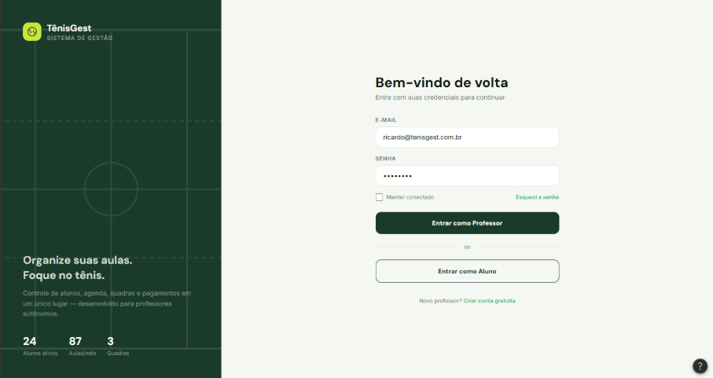

> A imagem original também exibe “Entrar como Aluno”. Ela foi mantida sem alterações; esse perfil não faz parte do recorte atual.

## Figura 2 — Dashboard da área do professor

A Figura 2 mostra o painel inicial (dashboard) da área do professor, que reúne as informações mais importantes da rotina de trabalho em uma única tela. Na parte superior, quatro indicadores apresentam a quantidade de alunos ativos, o número de aulas da semana, a receita do mês com o valor ainda pendente e a ocupação das quadras. Na sequência, a lista "Aulas de Hoje" exibe, para cada aula, o horário, o aluno, o nível técnico, a quadra e um indicador de status. À direita, o painel "Alertas" destaca pendências que exigem atenção, como mensalidades próximas do vencimento, reposições pendentes e atrasos de pagamento, e um gráfico semanal compara os valores recebidos e pendentes no mês. O botão "Nova Aula" permite iniciar rapidamente um agendamento.

## Figura 3 — Agenda semanal com janela de horário livre

A Figura 3 apresenta a agenda semanal do professor. A visualização organiza os dias da semana em abas na parte superior e, abaixo delas, uma grade em que cada coluna corresponde a uma quadra e cada linha a um horário, o que permite identificar rapidamente aulas marcadas e horários disponíveis. As aulas aparecem em cartões coloridos conforme o tipo (individual ou reposição). Ao selecionar um horário livre, o sistema exibe uma janela com a data, o horário e a quadra escolhidos, oferecendo a opção de agendar uma aula naquele horário ou fechar a janela.

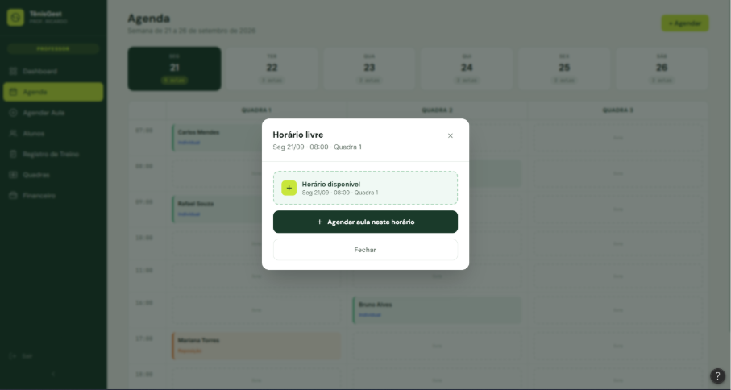

## Figura 4 — Agendamento rápido de aula

O agendamento de aulas pode ser realizado de duas formas. A primeira, mostrada na Figura 4, é um formulário rápido em janela, aberto a partir da agenda, no qual o professor informa o aluno, o tipo de aula (individual, em grupo de dois a quatro alunos ou reposição por chuva), o dia, a quadra, o horário e a recorrência, que pode ser aula única ou semanal, além de um campo opcional de observações.

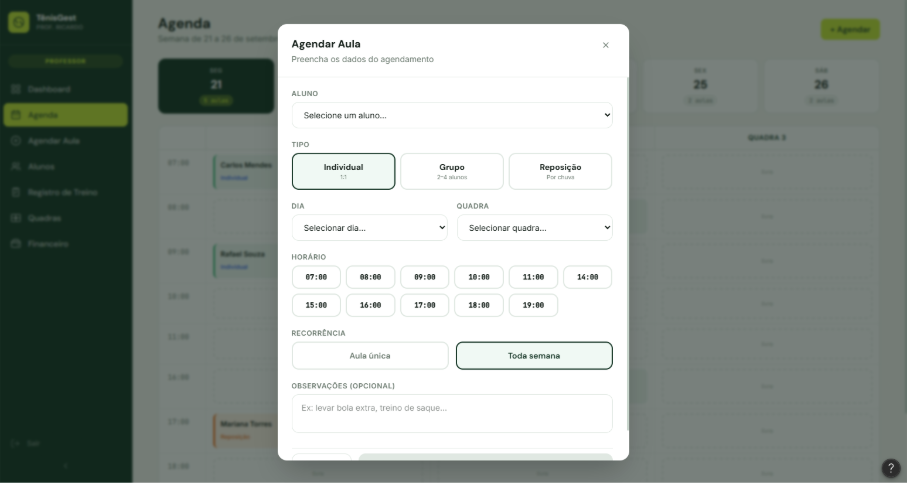

## Figura 5 — Agendamento de aula — aluno e tipo

A segunda forma é um fluxo guiado em três etapas, acessado pelo menu lateral e acompanhado de um indicador de progresso. Na primeira etapa (Figura 5), o professor seleciona o aluno, o tipo de aula e a quadra, identificada pelo tipo de piso: saibro, cimento ou sintético.

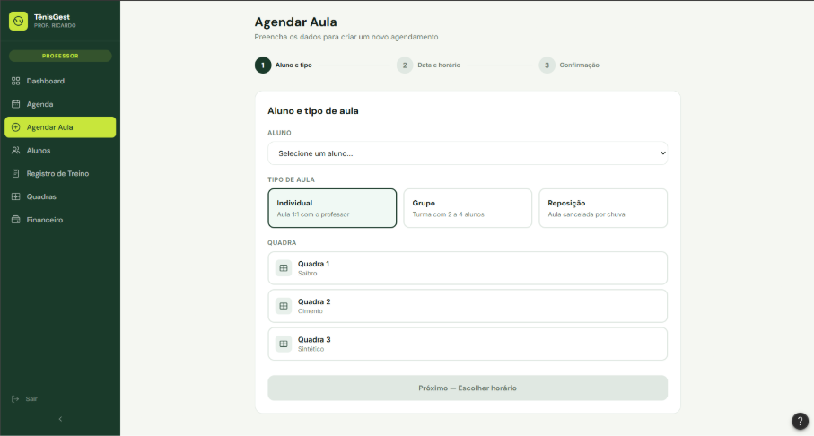

## Figura 6 — Agendamento de aula — data e horário

Na segunda etapa (Figura 6), o professor escolhe o dia da semana, o horário e a recorrência. Os horários já ocupados são sinalizados em vermelho e riscados, de modo a evitar conflitos de agenda.

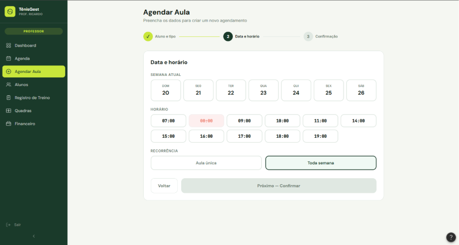

## Figura 7 — Agendamento de aula — confirmação

Na terceira etapa (Figura 7), o sistema apresenta um resumo do agendamento, com aluno, tipo de aula, data, horário, quadra e recorrência, além de um campo de observações, para conferência antes da confirmação final.

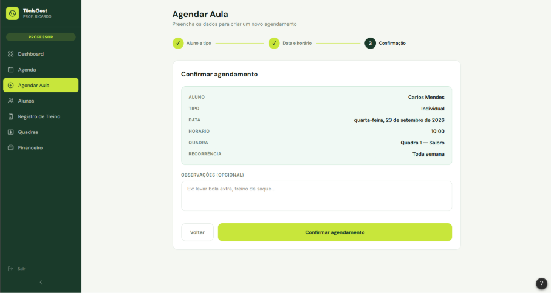

## Figura 8 — Gestão de alunos

A Figura 8 apresenta a tela de gestão de alunos, organizada em duas colunas. Na coluna da esquerda, há a lista de alunos cadastrados, com campo de busca e filtros por situação financeira (em dia, pendente e atrasado); cada item exibe as iniciais do aluno, o nível técnico, a situação de pagamento e a quantidade de aulas. Na coluna da direita, são exibidos os detalhes do aluno selecionado: dados de perfil e contato, pacote contratado com barra de progresso das aulas restantes e valor, próxima aula agendada e últimos treinos registrados, com as respectivas anotações do professor. A tela também oferece atalhos para consultar o histórico de aulas, registrar um novo treino e cadastrar novos alunos.

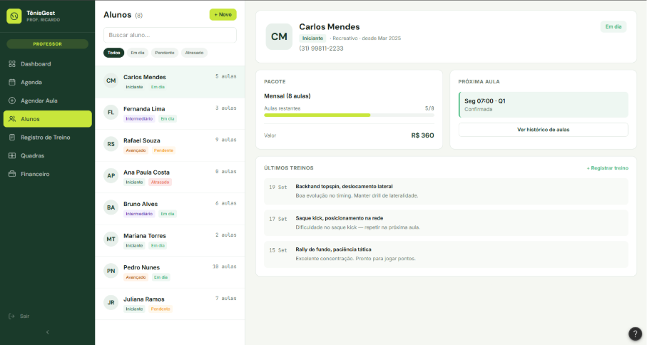

## Figura 9 — Registro de treino

A Figura 9 mostra a tela de registro de treino, na qual o professor documenta o que foi realizado em cada aula. No formulário principal, ele seleciona o aluno e a data, marca a presença (presente, falta ou reposição), indica o conteúdo trabalhado por meio de etiquetas selecionáveis, como rally de fundo, saque e voleio, ou por um conteúdo personalizado, e registra observações sobre pontos positivos, dificuldades e focos da próxima aula. No painel lateral, o professor pode atualizar o nível técnico do aluno, em uma escala numérica, para fundamentos como forehand, backhand, saque, devolução, voleios, deslocamento e tática. As alterações ficam registradas no histórico do aluno com a data do dia.

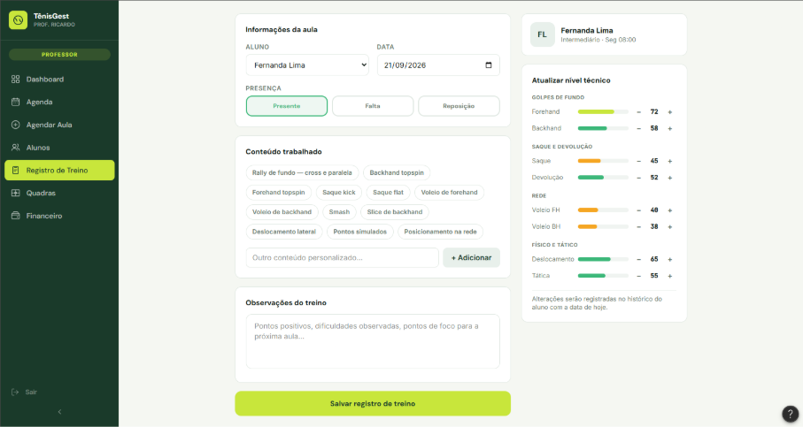

## Figura 10 — Gestão de quadras

A Figura 10 apresenta a tela de gestão de quadras. Na parte superior, cartões representam cada quadra com o tipo de piso, o status (disponível ou em manutenção), a quantidade de aulas do dia e o atalho para reservar horário. Abaixo, o professor escolhe o dia da semana e visualiza uma grade de horários por quadra, com identificação visual de aulas, horários livres, reservas particulares e períodos de manutenção, além do percentual de ocupação das quadras.

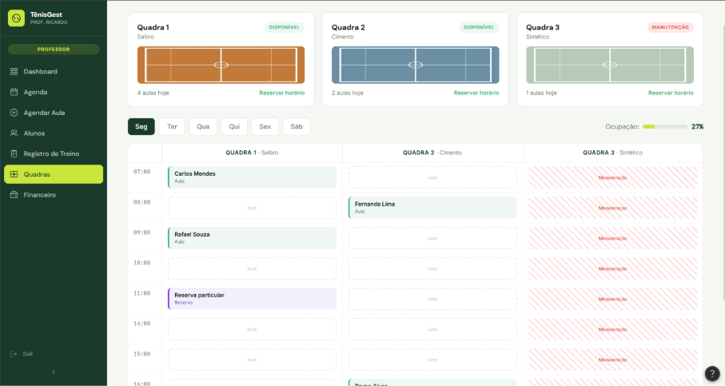

## Figura 11 — Controle financeiro

A Figura 11 apresenta a tela de controle financeiro. Na parte superior, três indicadores mostram os valores recebido, pendente e atrasado no mês, com a quantidade de pagamentos de cada situação. A aba "Lançamentos" lista as cobranças com aluno, descrição, tipo (mensalidade, pacote ou aula avulsa), vencimento, data de pagamento, valor e status, com filtros por situação; para cobranças pendentes ou atrasadas, o botão "Registrar" permite dar baixa no pagamento. A aba "Resumo por Aluno" complementa a tela com a visão individual por aluno. No lado direito, um gráfico de receita mensal e a distribuição da receita por tipo de cobrança auxiliam o acompanhamento do desempenho financeiro.

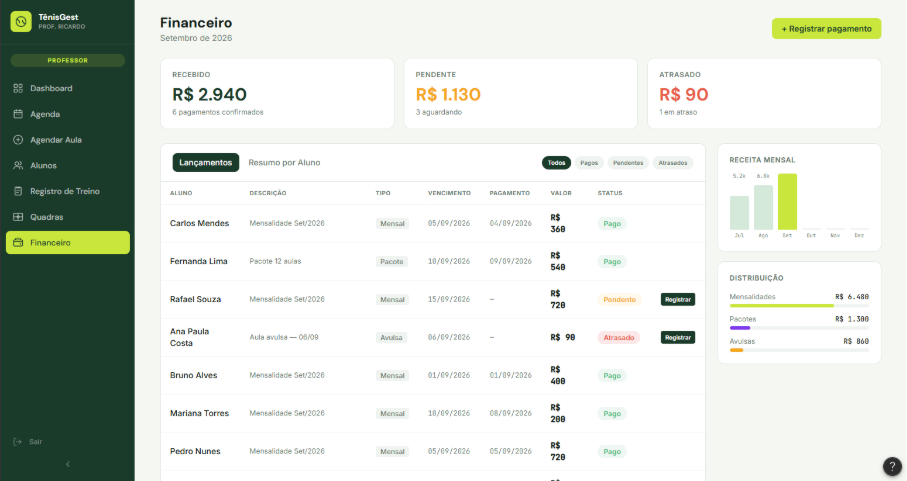

## Figura 12 — Registro de pagamento

Para registrar um pagamento, o professor utiliza a janela apresentada na Figura 12, na qual informa o aluno, o tipo de cobrança (mensalidade, pacote ou avulsa), o valor, o mês de referência, a forma de pagamento (PIX, transferência, dinheiro ou cartão), a data do pagamento e uma observação opcional.

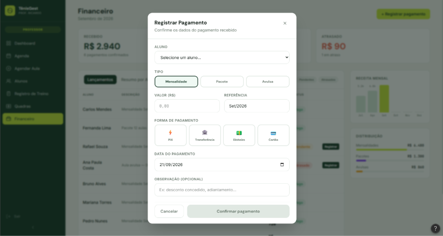

Fonte: texto e imagens do documento “Desenvolvimento de um Sistema de Gestão de Aulas Particulares de Tênis” (2026), fornecido pelo grupo. Recorte: área do professor.
